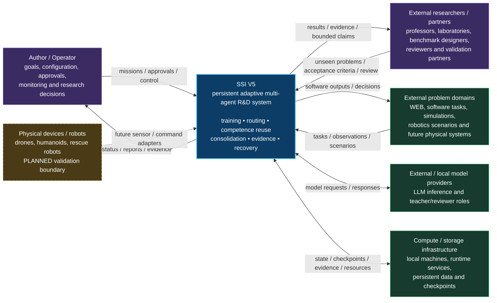

# SSI V5 — C4 Architecture

**Role:** canonical public architecture map / single source of truth  
**C4 scope:** Level 1 — System Context, Level 2 — Containers, Level 3 — Components  
**Created:** 2026-10-07  
**Last architectural review:** 2026-10-09  
**Implementation boundary:** proprietary code, credentials, reconstructive runtime internals and private prompts are intentionally excluded.  
**Evidence boundary:** architecture and status labels do not create new experimental claims. Completed, current, ready, installed, pre-build and planned states must remain distinct.

> **Maintenance rule — one file only:** this document is the canonical current architecture view of SSI V5.  
> When SSI architecture changes, update **this file** instead of copying new architecture diagrams into README, reviewer, roadmap or status documents.  
> Other current documents should link here. Older dated architecture files remain preserved as historical snapshots and are not retroactively rewritten.

## How to read this file

This document deliberately separates:

- **what SSI V5 is connected to** — C4 Level 1;
- **which major runtime/application boundaries exist** — C4 Level 2;
- **how a bounded task moves through the core decision/evidence path** — C4 Level 3.

Status tags used below:

- **CURRENT** — part of the present public architecture;
- **COMPLETED EVIDENCE** — bounded evidence has been published for that scope;
- **INSTALLED / NOT COMPLETED** — infrastructure exists, but the declared curriculum/result is not yet claimed complete;
- **READY / NOT COMPLETED** — preparation exists, but successful live completion is not yet claimed;
- **PRE-BUILD** — specified architecture, not claimed as an integrated completed module;
- **PLANNED** — future validation or physical integration, not claimed complete.

---

# C4 Level 1 — System Context

This level shows SSI V5 as one system and the people/systems around it.



## Context boundary

SSI V5 is not presented here as a single LLM. It is a persistent software ecosystem that coordinates separately identified agents, routing, competence storage, evidence, validation and recovery.

The public architecture does **not** claim:

- AGI, sentience or consciousness;
- production readiness;
- safety certification;
- completed physical robot validation;
- completed independent external replication.

---

# C4 Level 2 — Containers

This level shows the major runtime/application boundaries. The two most important separation rules are:

1. **DIRECTOR / SSI Final scope remains distinct from the CZARA research-collaboration scope.**
2. **BODY_FROZEN and BODY_FROZEN_1.0 are not treated as the same runtime identity merely because they can share compatible infrastructure or competence.**

```mermaid
flowchart TB
    subgraph UI["Human / Partner Interface"]
        reviewer["Public research portal / reviewer view<br/>CURRENT — observer / evidence boundary"]
        operator_ui["Operator control / monitoring<br/>CURRENT"]
        universal["Universal Lab: R3 + Caption R4 installed; R5 pending"]
    end

    subgraph FINAL["SSI Final Runtime Scope"]
        director_final["Director_Final<br/>mission orchestration / planning / adjudication"]
        body_final["BODY_FROZEN<br/>persistent execution body"]
        iskras["ISKRA1 .. ISKRA6<br/>separate persistent agent identities"]
        dynamic["Dynamic Mission V6<br/>INSTALLED / NOT COMPLETED"]
        web["WEB engineering path<br/>READY / NOT COMPLETED"]
    end

    subgraph CZARA_SCOPE["CZARA Research Collaboration Scope"]
        czara["CZARA<br/>conversation/research context<br/>first internal curriculum: COMPLETED EVIDENCE"]
        director_czary["Director_Czary<br/>research protocol / orchestration"]
        body10["BODY_FROZEN_1.0<br/>research execution / translation owner"]
        zerolab_c["ZeroLab — CZARA scope<br/>CURRENT bounded laboratory runtime"]
    end

    subgraph ROUTING["Routing / Competence Access"]
        v10["Router V10<br/>state/history/failure-aware routing"]
        s10["Router S10<br/>specialized competence routing layer"]
        micro["Micronetworks<br/>persistent validated competence"]
        champs["Candidate → Challenger → Champion<br/>qualification lifecycle"]
        blocks["BLOCKS family<br/>Pocket / Space / Navigator / Content / META-BLOCKS"]
    end

    subgraph LABS["Execution / Laboratory Layer"]
        zerolab_f["ZeroLab — Final scope<br/>CURRENT bounded laboratory runtime"]
        domain["Domain / World adapters<br/>software and simulation-facing"]
        mexico["Mexico / external partner benchmark path<br/>PLANNED external execution"]
    end

    subgraph RESEARCH_MEMORY["Research Memory / Meeting History"]
        direction TB
        meeting_link["Meeting Link V1: installed observation bridge"]
        research_memory["Research Memory P1: installed project history"]
        qualification_p3a["P3A reader: installed; trial gates pending"]
    end

    subgraph EVIDENCE["Persistence / Evidence / Recovery"]
        local_signer["Local Notary SSI: bounded P2B signing reported"]
        notary["Independent signing / notary authority<br/>R5+ TARGET / externally attested only when live"]
        evidence["Evidence + provenance<br/>PASS / INCONCLUSIVE / FAIL preserved"]
        continuum["CONTINUUM<br/>missions / checkpoints / evidence continuity"]
        state["Persistent state / memory / checkpoints"]
        recovery["Rollback / recovery / replay controls"]
    end

    subgraph EXTERNAL["External Dependencies"]
        llms["Local + external LLM providers"]
        infra["Compute / storage / IPC / runtime services"]
        robots["Physical robots / devices<br/>PLANNED validation"]
    end

    operator_ui --> director_final
    operator_ui --> director_czary
    reviewer --> evidence
    universal -.-> czara
    universal -.-> director_czary
    universal -.-> body10
    universal -->|"meeting observations: partially connected"| meeting_link
    meeting_link -->|"project observation history"| research_memory
    meeting_link -->|"matched observation anchors"| evidence
    FINAL -.->|"native artifact inventory checked locally"| qualification_p3a
    research_memory -.->|"version-bound trial evidence pending"| qualification_p3a
    qualification_p3a -.->|"future verified recommendations; not Router-bound"| v10

    director_final --> v10
    director_final --> s10
    director_final --> body_final
    director_final --> iskras
    dynamic --> director_final
    web --> body_final
    web --> iskras

    czara --> director_czary
    director_czary --> body10
    director_czary --> zerolab_c

    v10 <--> micro
    s10 <--> micro
    micro <--> champs
    micro <--> blocks

    v10 --> body_final
    v10 --> iskras
    s10 --> body_final
    s10 --> iskras

    body_final --> zerolab_f
    iskras --> zerolab_f
    body10 --> zerolab_c

    zerolab_f --> domain
    zerolab_c --> domain
    domain -.-> mexico
    domain -.-> robots

    director_final --> evidence
    director_czary --> evidence
    body_final --> evidence
    iskras --> evidence
    body10 --> evidence
    zerolab_f --> evidence
    zerolab_c --> evidence

    evidence <--> continuum
    evidence <--> state
    evidence -->|"bounded local signing checkpoints"| local_signer
    local_signer -.->|"independent attestation not established"| notary
    recovery <--> state
    recovery --> v10
    recovery --> s10

    director_final <-->|"inference / review"| llms
    director_czary <-->|"inference / review"| llms
    body_final <-->|"inference"| llms
    iskras <-->|"inference"| llms
    body10 <-->|"translation / inference"| llms

    FINAL <-->|"runtime resources"| infra
    CZARA_SCOPE <-->|"runtime resources"| infra
    EVIDENCE <-->|"persistent storage"| infra

    classDef current fill:#0b3d66,stroke:#55c2ff,color:#fff;
    classDef competence fill:#154a35,stroke:#67d391,color:#fff;
    classDef evidenceClass fill:#5a2449,stroke:#ff83cd,color:#fff;
    classDef planned fill:#4a3b16,stroke:#f0c04f,color:#fff,stroke-dasharray: 5 5;
    classDef prebuild fill:#44205e,stroke:#c58cff,color:#fff,stroke-dasharray: 5 5;

    class director_final,body_final,iskras,czara,director_czary,body10,zerolab_c,zerolab_f,reviewer,operator_ui current;
    class v10,s10,micro,champs,blocks competence;
    class meeting_link,research_memory,qualification_p3a current;
    class evidence,continuum,state,recovery,local_signer evidenceClass;
    class notary prebuild;
    class dynamic,web,mexico,robots planned;
    class universal prebuild;
```



## Container ownership and separation

### SSI Final

The SSI Final scope contains the primary Director, BODY_FROZEN and six ISKRA actors. These actors are evaluated as separately identified persistent entities rather than one interchangeable worker pool.

### CZARA scope

CZARA, Director_Czary and BODY_FROZEN_1.0 form a separate research-collaboration path. This scope is used to develop controlled Human-AI research interaction, laboratory protocol preparation, contextual assistance and the planned multilingual Universal Lab.

### Universal Lab integration boundary

**Live Gate R3 / 1.1.1 remains the installed authenticated web/session baseline.** The 2026-10-09 operator report adds an installed **Caption Chat R4** patch and confirms working translation on the MSI development host. Caption Chat provides original/translated captions, bounded visible history and revision-based corrections that preserve prior records. This targeted patch is distinct from the broader R4 package recorded as uninstalled in the earlier baseline.

ZeroLab V2 remains a separate bounded laboratory/runtime layer. The preserved knowledge-preparation state for CZARA / Director_Czary remains **INDEX_READY / NOT QUALIFIED**; the new installation reports do not establish completion of that prepared curriculum. The local-first, resource-bounded deployment remains tailored to the MSI GV62-8RE, i7, 16 GB RAM, GTX 1060 6 GB VRAM and local Ollama/qwen3:4b.

R5 remains the integration/verification target for the shared Conference timeline, DIRECTOR interaction, CZARA/Shadow, Router V10/Micronetwork telemetry and timings, BODY_FROZEN execution visibility, ZeroLab live validation and partner-safe session export. The caption, memory and signing updates do not establish all native bridges as live-bound or certify a completed partner meeting.

Current counts and installation reports belong in the [2026-10-09 progress report](RESULTS/UNIVERSAL_LAB_RESEARCH_MEMORY_PROGRESS_20261009.md) and [machine-readable summary](RESULTS/UNIVERSAL_LAB_RESEARCH_MEMORY_PUBLIC_SUMMARY_20261009.json). The [2026-10-07 meeting entry](UNIVERSAL_LAB_MEETING_START_HERE_20261007.md) and [installed-state record](SYSTEM/SSI_UNIVERSAL_LAB_STATUS_20261007.md) remain historical baseline/plan references.

### Research Memory and evidence authority boundary

Research Memory P1 stores project-scoped experience history. Meeting Link V1 partially connects Universal Lab meeting observations to that history and anchors the checked observation prefix in native session evidence. Meeting observations, transcripts and Shadow proposals do not automatically become verified skill trials or qualified competence.

P3A is an installed, separate native qualification-reader module. It inspected BODY_FROZEN and ISKRA1..6 artifacts and bound local eligibility reading during its check. The trial-evidence verifier and authoritative named-feature semantics remain unbound. The inspected memory has no ranked native cases, and **automatic Research Memory selection through Router V10 is not enabled**. The dashed recommendation connection represents future integration after exact-version trial verification and passive comparison, not current live routing authority.

P2B reports completion of local signing/backfill and verification through a fixed native session target. The local Notary/signing path is separate from the **independent attestation authority**, whose deployment is not established. This is operator-reported provenance within a bounded scope, not independent re-verification of the original private bundles or proof of semantic correctness. See the [evidence/notary contract](UNIVERSAL_LAB_EVIDENCE_NOTARY_AND_ATTESTATION_CONTRACT_20261008.md).

### Planned human-in-the-loop rehearsal and real meeting measurement

The next rehearsal uses **real Paweł responding to simulated Sara/Leire utterances**. Simulated participants have **no video**; their measured participant-facing content consists only of **Polish translations**. Source utterance, translation and real human response remain linked in the event history, with simulated versus real actors explicitly identified.

The measurement design separates source-to-translation latency, translation-to-visible-display latency, visible-display-to-first-observable-human-response time, human response completion time and backend decision/answer latency where actual events exist. A backend save timestamp alone does not establish when Paweł saw the translation. Missing first-response observations cannot be reconstructed from a final submitted message.

The rehearsal evidence package and measured report will be prepared **after that actual run**, with a sanitized publication planned **before the real partner meeting**. The real meeting should reuse the same event schema, timing boundaries and evidence method with actual participants. Neither the rehearsal export nor its results are claimed complete; simulated Sara/Leire output is not external partner participation, endorsement or independent validation. The [Reviewer Index](REVIEWER_INDEX.md) records the planned measurement boundaries.

### Shared infrastructure does not imply shared identity

The following can be shared or made compatible without merging runtime identities:

- compute;
- model providers;
- storage infrastructure;
- evidence formats;
- adapters;
- compatible competence transfer mechanisms.

A common provider, host or database does not by itself prove cross-agent learning or consolidation.

### Public/private boundary

This diagram intentionally exposes **roles and relationships**, not reconstructive implementation details. Public evidence may contain sanitized logs, hashes, summaries, state counts and verification tools while private implementation remains private.

---

# C4 Level 3 — Core Components and Execution Flow

This level explains the bounded execution loop without publishing proprietary code.

```mermaid
flowchart LR
    input["1. Task / Mission Input<br/>goal + context + acceptance criteria"]
    plan["2. Director Planning<br/>decompose / assign / set constraints"]
    route["3. Routing Decision<br/>V10 / S10<br/>REUSE • VERIFY • ADAPT • FULL_FLOW"]
    competence["4. Competence Selection<br/>Micronetwork / Champion / BLOCKS<br/>or new candidate path"]
    execute["5. Execution<br/>BODY / selected ISKRA / laboratory adapter"]
    validate["6. Validation<br/>declared checks / reviewer / comparison"]
    verdict{"7. Verdict"}
    evidence["8. Evidence + Provenance<br/>inputs • outputs • hashes • receipts • history"]
    promote["9A. Controlled Promotion<br/>candidate → challenger → champion<br/>only when gates permit"]
    recover["9B. Recovery / Re-route<br/>failure signature • alternate route<br/>rollback / escalation"]
    inconclusive["9C. Preserve INCONCLUSIVE<br/>do not silently convert to PASS"]
    result["10. Result / Report<br/>bounded claim + current state"]

    input --> plan --> route --> competence --> execute --> validate --> verdict
    verdict -->|"PASS"| evidence
    verdict -->|"INCONCLUSIVE"| inconclusive --> evidence
    verdict -->|"FAIL"| evidence

    evidence -->|"qualified reusable result"| promote
    evidence -->|"failure / mismatch / low confidence"| recover
    recover --> route

    promote --> result
    evidence --> result

    classDef step fill:#0b3d66,stroke:#55c2ff,color:#fff;
    classDef routing fill:#154a35,stroke:#67d391,color:#fff;
    classDef evidenceClass fill:#5a2449,stroke:#ff83cd,color:#fff;
    classDef recoveryClass fill:#5b2b1e,stroke:#ff9b71,color:#fff;
    classDef verdictClass fill:#4a3b16,stroke:#f0c04f,color:#fff;

    class input,plan,execute,validate,result step;
    class route,competence,promote routing;
    class evidence,inconclusive evidenceClass;
    class recover recoveryClass;
    class verdict verdictClass;
```



## Core component responsibilities

| Component | Public architectural responsibility |
|---|---|
| **Director** | mission planning, decomposition, orchestration, policy/acceptance control and result coordination |
| **Router V10** | state/history/outcome-aware route selection, confidence gating, failure-aware recovery and anti-blind-retry behavior |
| **Router S10** | specialized access/routing over qualified competence and task paths |
| **Micronetworks** | persistent reusable competence units whose lifecycle can be evaluated and promoted |
| **Candidate / Challenger / Champion** | explicit qualification lifecycle rather than treating every generated behavior as trusted skill |
| **BLOCKS** | modular competence/task composition layer used to decompose and recombine bounded capabilities |
| **BODY_FROZEN / BODY_FROZEN_1.0** | persistent execution bodies in distinct runtime scopes |
| **ISKRA1..6** | separate persistent agent identities used for independent learning/execution comparisons |
| **CZARA** | research-conversation context, structured assistance and controlled shadow research support |
| **ZeroLab** | bounded experiment/protocol execution layer with explicit authority and evidence boundaries |
| **Evidence / provenance** | preservation of outcomes, including failures and inconclusive states, with verification-oriented records |
| **CONTINUUM** | continuity across missions/checkpoints/evidence rather than treating every run as isolated |
| **Recovery / rollback** | controlled return, reroute, retry or escalation after detected failure/mismatch |

---

# Canonical execution principles

## 1. Reuse is conditional

```text
HIGH CONFIDENCE + VALID CONTEXT + QUALIFIED COMPETENCE
-> REUSE

AMBIGUOUS / MEDIUM CONFIDENCE
-> VERIFY / TOP-K / ADDITIONAL CHECK

LOW CONFIDENCE / UNKNOWN / CONFLICT
-> FULL_FLOW
```

## 2. Known failure should affect the next route

```text
COMPARABLE STATE
+ SAME FAILURE SIGNATURE
+ SAME ROUTE
+ NO NEW EVIDENCE

=> DO NOT BLINDLY REPEAT
```

The recovery path can select another competence, alter the BLOCKS composition, request verification, roll back to a checkpoint or escalate to a fuller execution path.

## 3. Evidence is not the same as promotion

A result can be recorded without becoming reusable trusted competence.

```text
RESULT
-> EVIDENCE
-> REVIEW / VALIDATION
-> QUALIFICATION GATE
-> OPTIONAL PROMOTION
```

This distinction is central to current evidence-safety work.

## 4. INCONCLUSIVE remains a first-class state

SSI V5 intentionally preserves unresolved outcomes instead of rewriting them as success. An INCONCLUSIVE result can trigger diagnosis, repair, rerouting or later retest while retaining its original provenance.

## 5. Separate actors remain separately measurable

BODY_FROZEN and ISKRA1..6 can be compared under the same curriculum while retaining separate state, routing history, skill lifecycle and recovery behavior. Later consolidation may be measured as a separate phase rather than silently mixed into the first comparison.

---

# Current architecture status map

This table is a **pointer**, not a replacement for the evidence documents.

| Area | Current architectural status |
|---|---|
| Persistent SSI Final actors | **CURRENT** |
| Director_Final / BODY_FROZEN / ISKRA1..6 separation | **CURRENT** |
| Router V10 / S10 competence routing | **CURRENT / development-validated in bounded published tests** |
| Micronetwork lifecycle | **CURRENT** |
| BLOCKS competence composition | **CURRENT** |
| Evidence / provenance / rollback concepts | **CURRENT** |
| CZARA first internal curriculum | **COMPLETED EVIDENCE** |
| ZeroLab V2 bounded local runtime | **CURRENT / bounded pilot evidence published** |
| Dynamic Mission V6 | **INSTALLED / curriculum completion not claimed** |
| WEB engineering curriculum | **READY / live completion not claimed** |
| Universal Lab | **R3 INSTALLED baseline / R5 integrations pending verification** |
| Caption Chat R4 | **INSTALLED / translation operator-confirmed; full UI acceptance not established** |
| Research Memory P1 / Meeting Link V1 | **INSTALLED / partially connected meeting-observation history** |
| Native qualification P3A | **INSTALLED / local eligibility reader checked; trial verifier and named-feature semantics unbound** |
| Research Memory contextual selection / Router V10 binding | **NOT ENABLED / version-bound trials and passive comparison pending** |
| Universal Lab local signing / Notary SSI | **BOUNDED P2B RESULT REPORTED / provenance, not semantic PASS** |
| Independent Universal Lab attestation authority | **PRE-BUILD TARGET / independent attestation not established** |
| Real-Paweł / simulated-Sara-Leire rehearsal | **PLANNED / evidence publication after the actual run, before the real meeting** |
| External Mexico benchmark | **PLANNED / not yet claimed executed** |
| Physical drone / humanoid / rescue-robot validation | **PLANNED / not claimed** |
| Independent multi-partner replication | **PLANNED / not claimed** |

For live evidence and current research status, use the repository's current truth/evidence documents. This C4 file should explain **structure**, not duplicate rapidly changing experimental counts.

---

# Update policy — keep architecture maintainable

When architecture changes:

1. **Edit this file only** for the C4 diagrams and architecture descriptions.
2. Update the **Created / last architectural review date** if the architecture itself changes materially.
3. Keep status words conservative: CURRENT, COMPLETED EVIDENCE, INSTALLED, READY, PRE-BUILD or PLANNED.
4. Do not copy these diagrams into other Markdown files.
5. Do not rewrite older dated architecture/evidence documents; they are historical records.
6. Other documents may link to a specific evidence result, but the current structural map should point back here.
7. If a new subsystem becomes important enough to appear in multiple current documents, add it here first and link to this file elsewhere.

## Stable link for other repository documents

Use this exact relative link:

```markdown
[SSI V5 — C4 Architecture](SSI_V5_C4_ARCHITECTURE.md)
```

This keeps future architecture maintenance concentrated in one place.

---

# Relationship to historical architecture documents

Dated architecture documents in the repository remain valuable because they show how SSI evolved. They should be interpreted as historical snapshots for their recorded dates.

**Current architecture pointer:** this file.  
**Historical snapshots:** preserved, not retroactively synchronized.

That distinction prevents a change in SSI V5 from requiring edits across dozens of old research records.


---

# Long-term programme map and Director knowledge coverage — 2026-10-12

**Status: PLANNING SYNTHESIS / proposed acceptance gates.** This section organizes already documented directions into a long-term programme. It introduces no completed experiment, deployment, hardware capability, autonomous authority or promised completion date. The dated evidence documents remain authoritative for their own measurements. Planning horizons below are dependency stages, not calendar commitments.

## Purpose and scope

SSI combines persistent competence, independent actor histories, software engineering, domain research and evidence. A meeting explanation must therefore cover the programme beyond routing or the current chat interface. Director knowledge should explain each domain's purpose, actors, workflow, example, published evidence, unresolved question and next acceptance gate.

The map below keeps three different tracks visible: existing software mechanisms and bounded results; research programmes still awaiting completion; and future physical or commercial applications. No domain inherits another domain's PASS.

## Horizon 1 — trustworthy access to the existing programme

1. **Complete the meeting knowledge coverage.** Provide independently addressable explanations for drones, Drone Mother, rescue robots, humanoids, cross-domain cooperation, offline operation, spatial BLOCKS, six ISKRA identities, Football World, Hermes, research methodology and future architecture. Provide short, extended and technical forms with aligned Polish/English content. Each factual explanation must point to a versioned source. Authored knowledge remains distinct from qualified native competence.
2. **Verify the actual conversation path.** Measure original speech/caption, final revision, translated display and Director response separately. Preserve speaker/session identity and distinguish private context from shared meeting context. Test names such as SSI, CZARA, ISKRA and BLOCKS, interrupted speech, translation failures, offline dependencies and duplicate events. No latency target is claimed achieved by this plan.
3. **Connect evidence-backed competence only through existing gates.** Research Memory observations must first acquire exact-version trial evidence and target eligibility. Compare recommendations passively before enabling Router selection. A knowledge card, catalog entry, signature or opened connection is insufficient evidence of native execution.

**Exit evidence:** source coverage matrix; bilingual interaction results; traceable response/translation events; explicit native execution versus prepared narration; preserved failure records. See [Universal Lab progress](RESULTS/UNIVERSAL_LAB_RESEARCH_MEMORY_PROGRESS_20261009.md) and [the evidence/notary contract](UNIVERSAL_LAB_EVIDENCE_NOTARY_AND_ATTESTATION_CONTRACT_20261008.md).

## Horizon 2 — core reliability and longitudinal actor comparison

1. Resolve the open evidence/review/transport failure paths with versioned repairs and regressions; preserve the earlier FAIL and INCONCLUSIVE records. Continue eligible core stages only when their declared prerequisites are met.
2. Complete the declared S11–S40 programme before claiming an S40 freeze. Bind each actor's identity, competence inventory, memory/checkpoint, routing history, evidence head and measured resource use to its own snapshot.
3. Preserve **BODY_FROZEN and ISKRA1–ISKRA6 as seven separate comparison lines**. The initial orientations are NICE, GUARDIAN, JUSTICE, EXPLORER, PRAGMATIST and SKEPTIC. They are initial experimental conditions, not guarantees of later behaviour.
4. Run WEB01–WEB24 as the planned post-S40 comparative phase. Keep the first comparison actor-isolated; assess learning curves and preserved rendered artifacts before a separately declared consultation/consolidation phase.
5. Study changes in affect-like software state, strategies, cooperation and artifact characteristics without treating self-report as subjective experience or correlation as causation.

**Exit evidence:** frozen per-actor baselines; task-level histories; held-out comparisons; quality, accessibility and responsive-behaviour results; routing/reuse/error/cost trajectories; evidence of any claimed difference. No S40 or WEB completion is added here. See [programme lineage](RESEARCH_PROGRAM_LINEAGE_AND_POST_S40_PLAN_20261004.md), [longitudinal protocol](LONGITUDINAL_S40_WEB_AND_AFFECT_STUDY_20261004.md) and [ISKRA starting conditions](BODY_ISKRA_6X_T0.md).

## Horizon 3 — domain programmes and bounded autonomy

| Domain | Established documentary starting point | Next planned work and acceptance evidence |
|---|---|---|
| Drones / swarm | Executed software-domain scenarios; preserved consolidation regression; separate post-S10 transfer results | Compare known/similar/novel tasks, sensor and communication degradation, route revision and unit loss. Retain scenario identity, baseline, reuse/verification decisions and regressions. |
| Drone Mother | Published software coordination and Dual Mother evidence | Bound mission allocation, information aggregation, relay and reassignment; measure coordination benefit and failure propagation under declared software scenarios. |
| Rescue robots | Dual Mother specialist classes include crawler, snake, quadruped, drilling, amphibious and heat-shielded concepts in software tests | Evaluate reconnaissance and access in mine, damaged-building, fire and flooded-tunnel scenarios. Tie every specialist claim to its tested adapter and environment. |
| Humanoids | Published software motion/stability and retained-experience results | Study balance recovery, obstacles, interrupted manipulation and modified task constraints; keep simulator time separate from execution wall time and physical motion. |
| Cross-domain / Dual Mother | Published deterministic consultation, consolidation and rollback experiments | Test incompatible observations and changed mission assumptions; preserve checkpoints, revised plans and target-specific retests after transfer. |
| OFFLINE_DIRECTOR | Planned bounded onboard role in the Mexico curriculum | Execute a previously authorized mission using qualified offline competence, record evidence locally and reconcile after reconnection. Missing outcomes must not trigger blind re-execution. |
| BLOCKS Space / Navigator / Offline | Planned spatial fragments, map deltas and no-network exchange | Evaluate local geometry, landmarks, uncertainty, map merging, store-carry-forward and bounded optical/acoustic relay in controlled environments. Do not infer a working physical adapter from a map representation. |
| Robert | Continuous engineering/execution lineage, separate from cleaned experimental BODY branches | Integrate only reviewed, versioned competence after target-specific regression. Keep observation, proposed action, authorized execution and observed outcome distinct. |

The Mexico robotics curriculum remains **48 planned stages: 38 training, 4 validation and 6 capstones**. The 38 training stages comprise 12 drone, 12 humanoid, 6 Mother/cross-domain and 8 offline stages. This plan does not claim those external stages are complete. It does not replace the earlier Drone Lab or mix the separate ISKRA longitudinal programme into the first robotics benchmark.

Primary references: [robotics/offline curriculum](MEXICO_ROBOTICS_TRAINING_AND_BENCHMARK_PLAN_20260926.md), [pre-benchmark protocol](MEXICO_PREBENCHMARK_RND_PROTOCOL_20260928.md), [drone measurements](DRONE_MEASURED_RESULTS_20260914.md), [humanoid measurements](HUMANOID_MEASURED_RESULTS_20260914.md), [Dual Mother results](RESULTS/DUAL_MOTHER_CROSS_LAB_V1_20260918.md) and [Robert continuity](ROBERT_CANONICAL_CONTINUITY_VS_EXPERIMENTAL_RESET_20260906.md).

## Horizon 4 — persistent worlds, knowledge generations and R&D

**Football World / HIPNOZA.** Close the documented source-ingress, match-identity and independent-outcome path. Preserve a prediction/decision before its outcome and retain T17/Hermes generation and agent Pocket identity. Compare model and strategy histories against outcomes rather than using one attractive prediction as proof. Existing implementation does not establish profitability or a complete automatic data path.

**Hermes and agent knowledge biographies.** Preserve which generation of a knowledge source an actor encountered, when it encountered it and what verified outcomes followed. Study whether different histories lead to reproducible changes in source trust, cooperation or strategy. Broader reputation-based and social-environment mechanisms remain research questions.

**Emerging worlds.** Additional economic/market domains begin with identified data and adequate history. Require declared collection, learning, held-out evaluation and independent outcomes before domain claims. A world description is not authorization for real-money execution or evidence of investment performance.

**Technology Radar.** Relate an identified external tool, model or method to an actual SSI need; compare it with an existing baseline in a bounded lab. Preserve source/version and the adopt/reject outcome. A promising discovery becomes a candidate, not an automatic core update. The older private-operational report and the deeper planned R&D integration have separate evidence boundaries.

**BODY_FROZEN 2.0.** Preserve its status as a proposed future R&D descendant. External problems in robotics, automation and industrial systems should move from available competence to identified gaps, prototype, test and versioned delivery. Internal SSI upgrades should move through candidate, sandbox, evidence, regression and explicit promotion; the running Champion must not be silently rewritten.

**Software and commercial applications.** WEB/software engineering and controlled training-package delivery can supply practical applications while the research programme continues. The published TRAIN08A commercial declaration concerns a specific reference package and target; it does not establish validated deployment in every customer environment. Client-specific requirements, data access, delivery acceptance and maintenance need their own records.

Primary references: [long-term origin and architecture](SSI_V5_ORIGIN_RESEARCH_METHODOLOGY_AND_LONG_TERM_ARCHITECTURE.md), [Football implementation boundary](RESULTS/FOOTBALL_WORLD_IMPLEMENTATION_BOUNDARY_20260922.md), [BLOCKS and Director laboratories](SYSTEM/LEGO_POCKET_META_LEGO_AND_DIRECTOR_LABS_20260922.md) and [commercial reference](COMMERCIAL_TRAIN08A_FOUNDATION_20260910.md).

## Horizon 5 — external validation and physical pilots

Maturity is earned for a named capability and environment through internal training, frozen validation, held-out tests, partner-defined unseen tasks, suitable simulation/digital-twin evaluation, controlled physical pilots and independent replication. These are evidence gates rather than a universal fixed timetable.

A physical pilot requires an identified device/adapter, domain-expert acceptance criteria, bounded operating conditions, appropriate human authority, stop/recovery behaviour and recorded observations. Software timing or simulated motion must not be presented as measured physical performance. Independent attestation concerns its explicitly verified evidence scope; it does not automatically certify every experiment or authorize deployment.

Partnership, funding and consortium documents can plan roles, resources, deliverables and validation capacity. They do not establish a signed partnership, an awarded grant, certified maturity or completed independent replication. See [current research roadmap](CURRENT_RESEARCH_ROADMAP_20261002.md), [partner entry](COLLABORATION_AND_PARTNER_ENTRY.md) and [TRL/validation planning](GRANT_CONSORTIUM/TRL_AND_VALIDATION_ROADMAP_20261001.md).

## Maintenance and reporting contract

- Keep this map in the canonical architecture document; link to dated protocols instead of duplicating their results.
- When a milestone changes state, attach the specific run/version, scope and evidence before changing its status.
- Give Director users source-backed explanations at the requested depth; distinguish historical result, current verified state and next planned work.
- Do not use meeting narration, translated text or a generated roadmap as proof of native skill execution, training completion or a new laboratory result.
- Keep unresolved questions visible. A later correction becomes a new version and preserves the earlier record.
